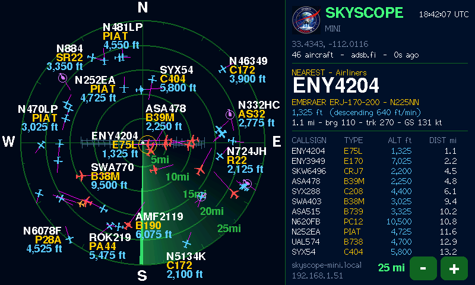

<p align="center"></p>

# SkyScope Mini

**A small standalone aircraft radar on a 4.3″ ESP32-S3 display. No Raspberry Pi needed.**
A Project Moon Pi project.

The Mini joins your Wi-Fi, fetches live aircraft from [adsb.fi](https://adsb.fi)'s
open data every five seconds, and draws them on an ATC-style scope with a
sweeping beam. It's a reduced [SkyScope](https://github.com/ricsne2010/skyscope)
sized for a microcontroller.



> **Early release.** 1.1.0 builds cleanly and its screen has been checked with
> the same drawing code running on a computer (the picture above), but it has not
> yet been run on the board itself. Please [open an issue](https://github.com/ricsne2010/skyscope-mini/issues)
> if something doesn't work.

## Documentation

- **[SkyScope Mini Guide (PDF)](docs/SkyScope-Mini-Guide.pdf)**: installing, Wi-Fi setup, location, touch controls, troubleshooting.
- The same guide as a web page: [docs/guide.html](docs/guide.html).

## Features

- Live aircraft from adsb.fi (up to 150), moved smoothly between updates
- Silhouettes or triangles, colour by kind, speed lines, tags that avoid each other, the sweep
- Runways and extended centrelines at major airports
- Filters by kind (airliners, business jets, GA, helicopters, military, other) and altitude block
- Emergency squawks (7500/7600/7700) flash and always show
- Nearest-aircraft card (or tap an aircraft to select it), list, UTC clock
- Touch −/+ range buttons: 5–100 km, 2–50 mi or 2–40 nm
- Settings page at `http://skyscope-mini.local`

For the full feature set (airspace, SIDs/STARs, photos, logos, your own SDR),
run [SkyScope](https://github.com/ricsne2010/skyscope) on a Pi and add a
[SkyScope Satellite](https://github.com/ricsne2010/skyscope-satellite) display.

## What you need

| Item | Details |
|---|---|
| Display | **Sunton ESP32-8048S043**: ESP32-S3 (16 MB flash, 8 MB PSRAM), 4.3″ 800×480, GT911 capacitive touch |
| Cable and power | USB-C data cable; any 5 V USB supply of 1 A or more |
| Network | 2.4 GHz Wi-Fi with internet access |

## Install

**From a browser (no tools needed):** download `skyscope-mini-1.1.0.bin` from the
[latest release](https://github.com/ricsne2010/skyscope-mini/releases/latest),
open the [ESP web flasher](https://espressif.github.io/esptool-js/) in Chrome or
Edge, connect to the board, and program the file at address **0x0**. If no port
shows up, hold **BOOT**, tap **RST**, release BOOT and connect again.

**From source with [PlatformIO](https://platformio.org):**

```sh
git clone https://github.com/ricsne2010/skyscope-mini.git
cd skyscope-mini
pio run -t upload
```

## First start

1. Join the Wi-Fi network **SkyScope-Mini-Setup** from a phone; the setup page
   opens. Choose your network and enter its password.
2. Open **http://skyscope-mini.local** (or the address at the bottom right of
   the screen) and enter your latitude and longitude. It starts centred on Amsterdam.
3. Save. Hold **BOOT** for 3 seconds any time to set up Wi-Fi again.

## Display hardware (pins)

Board revisions differ. If the screen is blank, shifted or the wrong colours,
or touch doesn't respond, set the wiring on the **Display hardware** page
(`http://skyscope-mini.local/hardware`) without rebuilding anything:

- the 16 RGB data lines, DE/VSYNC/HSYNC/PCLK and the backlight pin
- pixel clock, porches, sync polarities
- touch chip (GT911 or none), its pins and address

With a blank screen, hold **BOOT 3 s** and let go to start Wi-Fi setup, join
**SkyScope-Mini-Setup**, and press **Display hardware** there. Pins are checked before saving
(GPIO 1–21 or 38–48, no duplicates). **Hold BOOT 10 s**, or press *Restore
defaults*, to go back to the ESP32-8048S043 wiring.

## Code

| File | Does |
|---|---|
| `src/mini.cpp` | Saved settings; fetches adsb.fi on its own task, double-buffered |
| `src/mini_core.cpp` | Ranges and rings, aircraft classification (as SkyScope), reading adsb.fi's JSON |
| `src/render.cpp` | Draws the screen: runways, sweep, aircraft, labels, card, list, buttons |
| `src/scope.cpp` | Scope drawing shared with SkyScope Satellite |
| `src/device.cpp` | Splash, Wi-Fi setup, BOOT button, mDNS |
| `src/main.cpp` | Start-up, touch, settings page |
| `include/board.h`, `board_pins.h` | The display driver and its default wiring |
| `src/hardware.cpp` | The Display hardware page; the wiring saved in flash |
| `include/shapes.h` | Aircraft silhouettes, generated from SkyScope by `tools/gen_shapes.py` |
| `src/data/` | Major-airport runways from OurAirports (`tools/build_large_airports.py`) |
| `tools/preview/` | Builds the drawing code on a computer and renders a frame to an image |

## Credits and licence

MIT licence (see [LICENSE](LICENSE)). SkyScope grew out of
[ESP32-Plane-Radar](https://github.com/MatixYo/ESP32-Plane-Radar) by MatixYo
(MIT), and the runway table tool comes from it. Aircraft data:
[adsb.fi](https://adsb.fi) open data. Airports: OurAirports (public domain).
Libraries: LovyanGFX (FreeBSD), WiFiManager (MIT), ArduinoJson (MIT). The
Project Moon Pi name and logo are not covered by the licence. Not for navigation.
